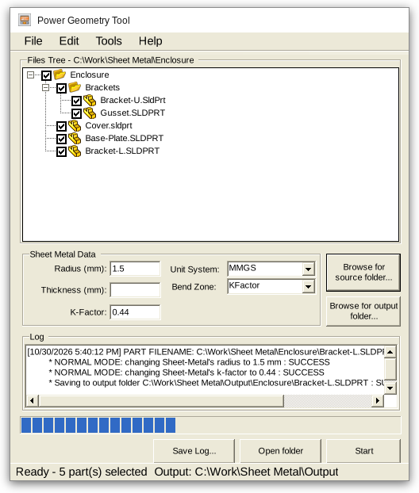
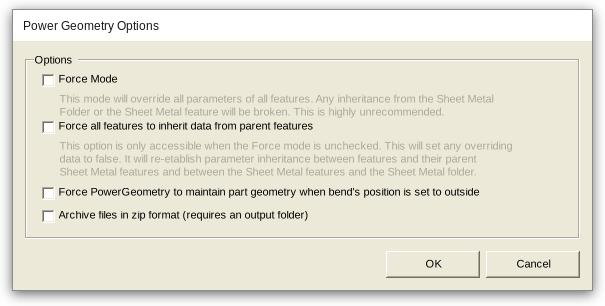

# Power-SM add-in for SOLIDWORKS

Power-SM is a free sheet metal add-in for SOLIDWORKS. Its **Power Geometry Tool** changes the bend radius, thickness and K-factor / bend allowance / bend deduction of every sheet metal part in a folder, in one run.

Updating hundreds of sheet metal parts by hand is slow and error-prone, especially in high-volume manufacturing. Power-SM takes care of that so design engineers can focus on design.

## Features

- Batch-edit every `.sldprt` in a folder and its subfolders. Check or uncheck parts in the files tree.
- Change the **bend radius**, **thickness** and **bend zone** (K-factor, bend allowance or bend deduction). Leave a value empty to keep it as it is.
- Enter values in **MMGS** (mm) or **IPS** (in). The part's own document units don't matter.
- **Normal mode** (default): changes are made on the Sheet Metal folder and flow down to every feature that inherits from it.
- **Force mode**: the values are written on every sheet metal feature, which breaks inheritance. Not recommended.
- **Inherit from parent** option: removes overriding parameters, so every feature goes back to inheriting from its parent sheet metal feature and folder.
- **Keep part geometry** option: when an edge flange's position is *bend outside*, it is offset so the outside dimensions don't change.
- Save the changed parts **in place**, to an **output folder** that keeps the source folder structure, or as a **zip archive** (`powersm.zip`).
- A log for every part, which you can save to a text file.

## Installation

1. Close SOLIDWORKS.
2. If an older version of Power-SM is installed, uninstall it from **Windows Settings > Apps**.
3. Download `setup_x64_1.5.exe` from the [Releases](https://github.com/AmenJlili/power-sm/releases) page and run it as administrator.

**Requirements:** 64-bit Windows, 64-bit SOLIDWORKS, .NET Framework 4.5 or later.

## Usage

1. Start SOLIDWORKS and go to **Tools > Add-ins**. Enable **Power-SM**, and check *Start Up* if you want it to load every time.
2. With **no document open**, select **PowerSM > Power Geometry Tool**.
3. Click **Browse for source folder...**. All parts in the folder are listed and checked.
4. Optional: click **Browse for output folder...** to save the changed parts somewhere else instead of overwriting them. Right-click the button to clear the output folder.
5. Pick the unit system and bend zone type. Then enter the new radius, thickness and/or bend zone value.
6. Click **Start**. Progress and results show in the log.

Options are under **Tools > Options** and are saved per user in `%APPDATA%\Blue Byte\PowerSM\settings.xml`.

## Building from source

- Open `PowerSM/PowerSM.sln` in Visual Studio and restore the NuGet packages (`BlueByte.SOLIDWORKS.Interops`).
- Build **Release**. The add-in is `PowerSM/PowerSM/bin/Release/PowerSM.dll`.
- Build the installer with [NSIS 3](https://nsis.sourceforge.io): `makensis installer\PowerSM.nsi`. The output is `installer\output\setup_x64_<version>.exe`.
- For development without the installer, register the DLL from an elevated prompt:
  `%WINDIR%\Microsoft.NET\Framework64\v4.0.30319\RegAsm.exe /codebase PowerSM.dll`

## Version history

- 10/30/2026: **1.5**. Fixed unit conversion for inch parts and Force mode. Bend allowance / deduction values above 1 are now accepted. Options now persist between sessions. Parts are closed properly after processing. UI clean-up: unit labels, read-only log, output folder in the status bar, OK / Cancel in Options. New NSIS installer. See [installer/Changes.txt](installer/Changes.txt).
- 07/22/2020: 1.3 improvements
- 06/15/2016: 1.4 release
- 04/14/2016: 1.2 release
- 01/20/2016: 1.1 release
- 01/03/2016: 1.0 release

## License

GNU. Free to use and share.

Maintained by [Blue Byte Systems Inc.](https://bluebyte.biz)
